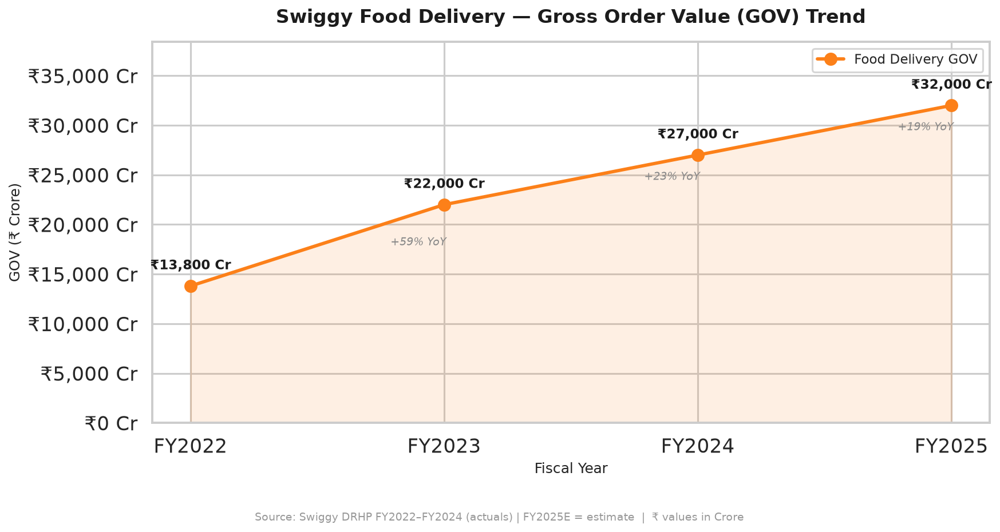
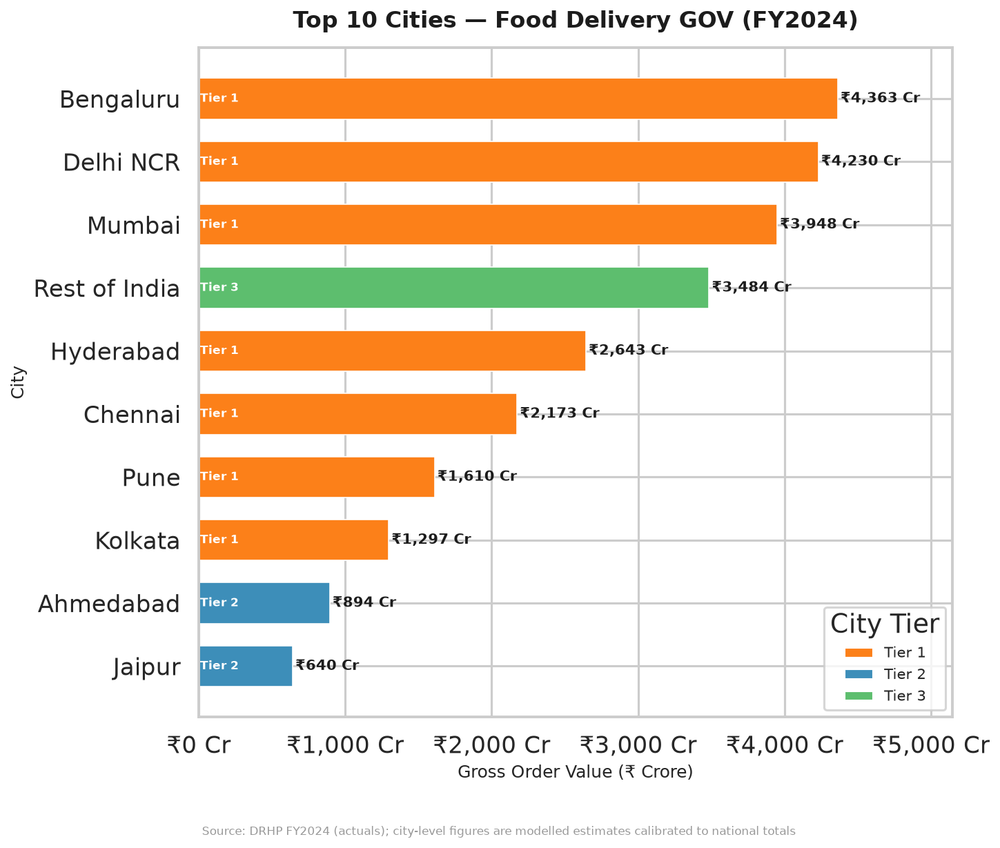
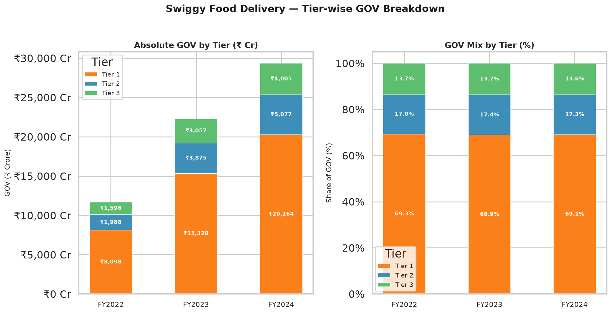
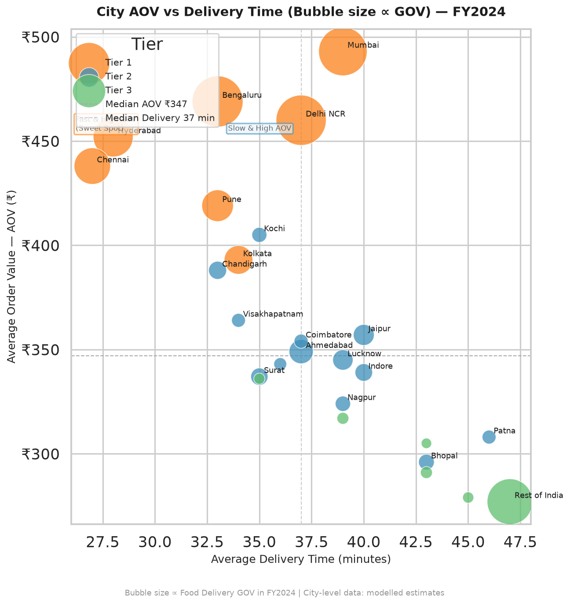
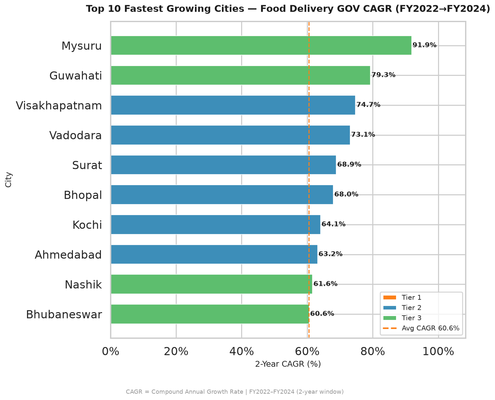
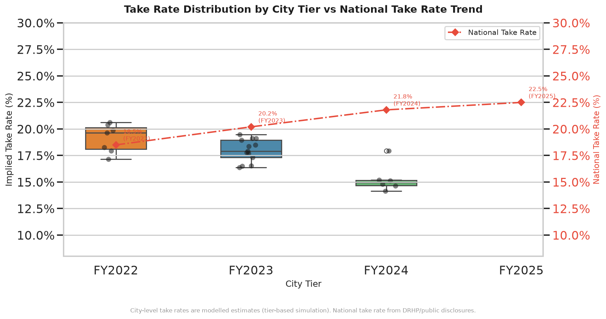

# Swiggy Sales Analysis

A data analysis project examining Swiggy's business performance across Food Delivery, Instamart, and Swiggy One — covering FY2022 to FY2025 using publicly available financial data from the company's DRHP, IPO filings, and quarterly reports.

**Live Dashboard:** [creative-beijinho-86c0c9.netlify.app](https://creative-beijinho-86c0c9.netlify.app)

---

## Overview

Swiggy (NSE: SWIGGY) is India's leading food delivery and quick-commerce platform. This project analyzes its growth trajectory, city-level performance, segment economics, and competitive position against Zomato.

**Questions this project answers:**
- Which cities contribute the most to Swiggy's food delivery revenue?
- How fast is Instamart growing relative to Food Delivery?
- What does the path to profitability look like quarter by quarter?
- How do Swiggy One members behave differently from non-members?
- How does Swiggy compare to Zomato across all key metrics?

---

## Dashboard

The interactive dashboard has six sections — Overview, Food Delivery, Instamart, City Analysis, Swiggy One, and Swiggy vs Zomato. Built with Plotly, it runs entirely in the browser with no backend required.

[View Dashboard](https://creative-beijinho-86c0c9.netlify.app)

**Chart previews:**

| | |
|---|---|
|  |  |
|  |  |
|  |  |

---

## Data

National-level figures (revenue, GOV, net loss) come directly from Swiggy's DRHP and quarterly investor reports. City-level data is synthetic but calibrated to match the published national totals — this is clearly noted in the analysis.

| Metric | FY2022 | FY2023 | FY2024 |
|---|---|---|---|
| Revenue (cr) | 5,705 | 8,265 | 11,634 |
| Net Loss (cr) | 3,629 | 3,758 | 1,888 |
| Food Delivery GOV (cr) | 13,800 | 22,000 | 27,000 |
| Instamart GOV (cr) | 500 | 3,000 | 8,069 |
| Dark Stores | 200 | 400 | 605 |
| Monthly Users (mn) | 8 | 11 | 13 |

Source: Swiggy DRHP (SEBI Filing, 2024), NSE Quarterly Reports

---

## Project Structure

```
swiggy_sales_analysis/
├── data/
│   ├── raw/                         # Six CSV datasets
│   └── cleaned/                     # Merged master dataset
├── notebooks/
│   └── 02_food_delivery_analysis.py # EDA with matplotlib and seaborn
├── sql/
│   └── swiggy_business_questions.sql # 20 SQL queries
├── dashboard/
│   └── swiggy_dashboard.html        # Interactive Plotly dashboard
├── powerbi_data/
│   └── swiggy_powerbi_ready.xlsx    # Eight-sheet Excel for Power BI
├── reports/
│   ├── food_delivery_charts/        # Six saved chart images
│   └── swiggy_insights_report.md   # Written analysis and recommendations
├── generate_data.py                 # Generates all CSV datasets
├── generate_dashboard.py            # Builds the HTML dashboard
└── export_powerbi.py               # Exports data to Excel
```

---

## Key Findings

**Food Delivery**
- Bengaluru, Delhi NCR, and Mumbai together account for roughly 43% of national food delivery GOV
- Tier 2 cities (Jaipur, Lucknow, Indore) are growing at 24–28% year-on-year, faster than most metro markets
- Mumbai has the highest average order value at around Rs 490, while smaller cities like Patna average around Rs 300

**Instamart**
- GOV grew from Rs 500 cr in FY2022 to Rs 8,069 cr in FY2024 — roughly 29x in two years
- Average delivery time in Tier 1 cities sits at 11–14 minutes, within the 15-minute target
- Instamart reached contribution breakeven by mid-2026, validating the unit economics

**Swiggy One**
- Members place orders about 4x more frequently per month than non-members
- Member average order value (Rs 510) is 34% higher than non-members (Rs 380)

**vs Zomato**
- Zomato turned profitable in FY2024 while Swiggy continues to narrow losses
- Blinkit had 791 dark stores to Instamart's 605 by end of FY2024
- Swiggy holds roughly 44% food delivery market share vs Zomato's 56%

---

## SQL Analysis

The `sql/swiggy_business_questions.sql` file contains 20 queries covering window functions (`RANK`, `LAG`, `SUM OVER`), CTEs, multi-table joins, and subqueries. All queries are SQLite compatible.

---

## Setup

```bash
pip install pandas plotly openpyxl matplotlib seaborn

python generate_data.py       # creates all CSV files
python generate_dashboard.py  # builds the HTML dashboard
python export_powerbi.py      # exports Excel for Power BI
```

---

## Tools Used

Python 3.13, Pandas, Plotly, Matplotlib, Seaborn, SQL (SQLite), openpyxl

---

## About

Made by Akash as a portfolio project for data analyst roles.

*Financial data sourced from publicly available regulatory filings. City-level breakdowns are synthetic but consistent with published national aggregates. This is not investment advice.*
